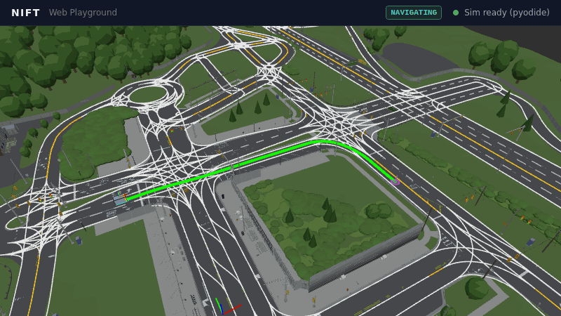

# NiFT Autonomous Shuttle: ROS 2 Autonomy Stack

[](https://github.com/Kane-Weng/NiFT-AV-shuttle/actions/workflows/ci.yml) [](LICENSE)

This is the ROS 2 software stack for the **NiFT autonomous shuttle**, a low-speed self-driving shuttle that we develop and test at [Mcity](https://mcity.umich.edu/), the University of Michigan's proving ground for automated vehicles. It takes the shuttle from raw sensor data to drive-by-wire CAN commands. Two RTK GNSS antennas give the position and heading, and a LiDAR finds obstacles. A Lanelet2 route planner draws a smooth path. Pure Pursuit steers, an ADRC controller holds the speed, and safety filters slow or stop the shuttle near obstacles. The simulator replaces only the hardware (the GNSS server, the LiDAR and the drive-by-wire ECU), so the code we test in simulation is the code that drives the shuttle. A web dashboard and RViz panels let an operator watch and control it.

**[Try it in your browser](https://kane-weng.github.io/nift_playground/).** The web playground runs our own ROS 2 nodes in the page, on a small fake ROS, with nothing to install. Set a goal, start the shuttle, cut its GNSS and watch the real controller react.

[](https://kane-weng.github.io/nift_playground/)

## How it fits together

```
GNSS + LiDAR ──► nift_sensor ──► nift_waypoint ──► nift_control ──► /to_can_bus ──► shuttle ECU
(or nift_carla)   pose, obstacles    route, path       steer, speed      CAN frames      (or nift_carla's virtual ECU)
```

`nift_bringup` starts the whole chain from one launch file, and `nift_common` holds the facts every package shares. The wiki page [System Architecture](https://github.com/Kane-Weng/NiFT-AV-shuttle/wiki/System-Architecture) shows the full graph.

## Packages

| Package | What it does | Docs |
|---|---|---|
| `nift_common` | Shared facts: the shuttle's size and limits, sensor mounts, the CAN protocol and the map origin | [README](nift_common/README.md), [wiki](https://github.com/Kane-Weng/NiFT-AV-shuttle/wiki/nift_common) |
| `nift_sensor` | Reads the RTK GNSS beacons, fuses them in an EKF, publishes `map → base_link`, and turns LiDAR scans into obstacle polygons | [README](nift_sensor/README.md), [wiki](https://github.com/Kane-Weng/NiFT-AV-shuttle/wiki/nift_sensor) |
| `nift_waypoint` | Routes on a Lanelet2 map and joins the route to the shuttle and the goal with Bezier curves | [README](nift_waypoint/README.md), [wiki](https://github.com/Kane-Weng/NiFT-AV-shuttle/wiki/nift_waypoint) |
| `nift_control` | Pure Pursuit steering, ADRC speed control, safety filters, a mode state machine and the CAN frame encoder | [README](nift_control/README.md), [wiki](https://github.com/Kane-Weng/NiFT-AV-shuttle/wiki/nift_control) |
| `nift_bringup` | One system launch with named profiles, preflight checks and a desktop launcher | [README](nift_bringup/README.md), [wiki](https://github.com/Kane-Weng/NiFT-AV-shuttle/wiki/nift_bringup) |
| `nift_web` | Launches the rosbridge WebSocket server for the dashboard | [README](nift_web/README.md), [wiki](https://github.com/Kane-Weng/NiFT-AV-shuttle/wiki/nift_web) |
| `nift_web_frontend` | React dashboard: live map, route, obstacles, telemetry, node health and operator controls (not a ROS package) | [README](nift_web_frontend/README.md), [wiki](https://github.com/Kane-Weng/NiFT-AV-shuttle/wiki/nift_web) |
| `shuttle_description` | URDF of the shuttle as boxes with its real sizes, plus the RViz configs | [README](nift_simulation/shuttle_description/README.md), [wiki](https://github.com/Kane-Weng/NiFT-AV-shuttle/wiki/shuttle_description) |
| `nift_rviz_plugins` | Three RViz panels: navigation controls, TF monitor and system health | [README](nift_simulation/nift_rviz_plugins/README.md), [wiki](https://github.com/Kane-Weng/NiFT-AV-shuttle/wiki/nift_rviz_plugins) |
| `nift_carla` | Two simulator backends behind the same CAN and GNSS interfaces: a CARLA bridge and a kinematic model that needs no GPU | [README](nift_simulation/nift_carla/README.md), [wiki](https://github.com/Kane-Weng/NiFT-AV-shuttle/wiki/nift_carla) |
| `maps/` | The Lanelet2 map the simulation drives on, with its license notice | [README](maps/README.md) |
| `nift_playground` | The simulation in a web page: our nodes on a fake ROS in the browser, with an optional 3D view of the test site (not a ROS package) | [README](nift_playground/README.md), [wiki](https://github.com/Kane-Weng/NiFT-AV-shuttle/wiki/Web-Playground) |

`shuttle_description`, `nift_rviz_plugins` and `nift_carla` live in [`nift_simulation/`](nift_simulation/README.md).

## Quick start

The stack runs on Ubuntu 22.04 with ROS 2 Humble. Clone this repository as the `src/` folder of a colcon workspace. Then install the dependencies and build, as CI does.

```bash
mkdir -p ~/nift_ws && cd ~/nift_ws
git clone https://github.com/Kane-Weng/NiFT-AV-shuttle.git src
rosdep install --from-paths src --ignore-src --rosdistro humble -y
find src -name requirements.txt -not -path '*/node_modules/*' -print0 | xargs -0 -r -n1 pip3 install -r
colcon build --symlink-install
source install/setup.bash
```

Run the tests:

```bash
colcon test && colcon test-result --verbose
```

Drive the full stack in simulation, with no CARLA and no GPU:

```bash
ros2 launch nift_bringup system.launch.py profile:=sim_kinematic
```

RViz opens on the simulation map. Set a goal with **2D Goal Pose**, then press **Start Navigation** in the Navigation panel. This profile uses a kinematic model with no LiDAR, so the safety filter is off.

The wiki's [Getting Started](https://github.com/Kane-Weng/NiFT-AV-shuttle/wiki/Getting-Started) page covers the rest: the CARLA simulation, the web dashboard and the real shuttle.

## Documentation

The [project wiki](https://github.com/Kane-Weng/NiFT-AV-shuttle/wiki) explains each package and node in depth. It also covers the background for engineers new to autonomous vehicles: the hardware (CAN, LiDAR, GNSS), the middleware (ROS 2, Linux) and the algorithms (localization, planning, control, simulation).

## My role

I'm Kane Weng. I lead the NiFT shuttle team, and I designed and wrote this autonomy stack.

- **Team lead:** I lead the whole team.
- **System planning and integration:** I plan the system and integrate its packages into one stack that runs on the shuttle and in simulation.
- **Research:** I research autonomous vehicle stacks and their algorithms.
- **ROS workspace:** I set up the ROS 2 workspace and its package layout.
- **Code:** I implement and maintain the code, and I run its version control.

## Acknowledgements

- Chun Ho "Jimmy" Wang co-wrote parts of the route planner (`nift_waypoint`) and the two navigation RViz configs in `shuttle_description/rviz/`.
- The NiFT shuttle team at the University of Michigan.
- Mcity, for the test facility.
- `maps/lanelet2_odr2024.osm` is generated from the 2024 OpenDRIVE file of the public [Mcity Digital Twin](https://github.com/mcity/mcity-digital-twin), which is MIT licensed. Its notice is in [`maps/README.md`](maps/README.md). This project is not affiliated with or endorsed by its owners.
- The `nift_waypoint` demo uses the example map that ships with [Lanelet2](https://github.com/fzi-forschungszentrum-informatik/Lanelet2).

## License

[Apache-2.0](LICENSE), except `maps/lanelet2_odr2024.osm`, which keeps the MIT license of its source (see [`maps/README.md`](maps/README.md)).
