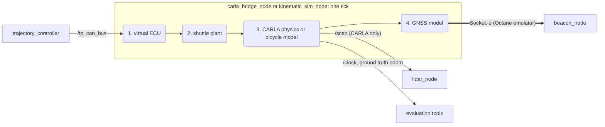

# nift_carla

`nift_carla` is the simulator of the NiFT shuttle. It plays the parts of the vehicle that the hardware provides: the drive-by-wire ECU, the GNSS beacons and the LiDAR. Everything else, from `beacon_node` to `trajectory_controller`, runs the same code as on the shuttle. Wiki page: [nift_carla](https://github.com/Kane-Weng/NiFT-AV-shuttle/wiki/nift_carla).

It has two backends with one contract:

- **CARLA bridge** (`carla_bridge_node`). Connects to a CARLA 0.9.15 server that runs the public [Mcity Digital Twin](https://github.com/mcity/mcity-digital-twin), a 3D model of the test track. CARLA adds terrain, props, other actors and a LiDAR. It needs an NVIDIA GPU with at least 6 GB.
- **Kinematic backend** (`kinematic_sim_node`). A kinematic bicycle model on a flat, empty world. No CARLA, no GPU, no LiDAR. It runs anywhere the stack builds, also faster than real time.



Every tick (20 Hz of sim time, the backend is the `/clock` source) the virtual ECU decodes the controller's CAN frames (0x101 command, 0x100 E-stop). The shuttle plant turns pedal and brake counts into the speed the real shuttle would reach. CARLA's physics, or the bicycle model, moves the vehicle. The GNSS model then serves both antenna fixes the way the Octane RTK server does, so `beacon_node` runs its real branch. No node in the stack knows it is in simulation.

## What the simulator reproduces

| Interface | Direction | Contract |
|---|---|---|
| Octane Socket.io (`octane_emulator.py`) | sim → stack | `http://127.0.0.1:8765`, namespace `/octane`: `auth` → `auth_ok`, `join` → channel, one `beacon_update` per antenna per tick in the published Octane schema (velocity in knots, as the real feed). Antennas ±1.041 m from `base_link`, IDs `SIM-FRONT` / `SIM-REAR`. Port, key and IDs come from `octane.*` in `carla_params.yaml` |
| `/to_can_bus` | stack → sim | `can_msgs/Frame`: 0x101 command (gear, brake, pedal, steer) and 0x100 E-stop, stamped with sim time. No 0x101 for `dbw.cmd_timeout_s` (0.5 s) means full brake |
| `/scan` | sim → stack | `PointCloud2`, frame `velodyne`, 10 Hz, 8 channels × 180 rays, mounted as in the URDF. CARLA backend only |
| `/clock` | sim → stack | sim time; every node runs with `use_sim_time` |
| `/ackermann_like_controller/odom` | sim → tools | ground truth of `base_link` in `map`, for the evaluation tools. Nothing in the stack subscribes |
| `/initialpose` | RViz → sim | teleports the vehicle (map frame) |
| `/carla/dbw_state`, `/carla/gps_health`, `/carla/gnss_fault`, `/diagnostics` | sim → tools | ECU and plant state as JSON, GNSS dropout flag, scheduled GNSS faults, backend health |

The simulator publishes no TF. `robot_state_publisher` gives the sensor frames from the URDF and `shuttle_tf_node` gives `map → base_link` from GNSS, exactly as on the shuttle.

## How the two backends compare

| | CARLA bridge | Kinematic backend |
|---|---|---|
| Longitudinal (pedal, brake → speed) | `shuttle_plant.py`, fitted to a garage test on the shuttle | the same |
| CAN path, watchdog, E-stop latch | `carla_dbw.py` | the same |
| GNSS (antenna fixes, noise, dropout, faults) | `sim_gnss.py` → Octane emulator | the same |
| Lateral | CARLA's tyre physics on the vehicle body | kinematic bicycle on the shuttle's geometry (no tyre slip, instant steering) |
| World | the twin: terrain, props, scenario obstacles | flat and empty (spawn and waypoints apply, obstacles are ignored) |
| LiDAR, perception, safety filter | yes | no (`perception` must be off) |
| Needs | CARLA server, NVIDIA GPU ≥ 6 GB, the `carla` wheel | nothing beyond the build |

On five test routes the two backends tracked within a few centimetres of each other, so the kinematic backend is good for tuning. Confirm aggressive turns and anything perception related in CARLA or on the shuttle.

## Running

Both backends start from `nift_bringup`, which also starts the stack:

```bash
ros2 launch nift_bringup system.launch.py profile:=sim_kinematic        # kinematic backend, full stack minus perception
ros2 launch nift_bringup system.launch.py profile:=sim                  # CARLA backend (server must be up, see below)
ros2 launch nift_bringup system.launch.py profile:=sim_filter_bench filter_type:=cbf   # safety-filter bench in CARLA
```

Set a goal with RViz "2D Goal Pose", then call `/start_navigation`. "2D Pose Estimate" teleports the vehicle. The filter bench uses `config/scenarios/filter_bench.yaml`: a straight road, a static path and three obstacles (a pedestrian, a cone and a parked car).

On their own, without the stack:

```bash
ros2 launch nift_carla carla_bridge.launch.py          # bridge only (carla_host:=<ip> for a remote server)
ros2 launch nift_carla kinematic_sim.launch.py         # kinematic backend only
```

Faster than real time: `time_factor:=10` works on the kinematic backend. `time_factor:=0` does not, because the free-running clock outruns the Octane socket and `beacon_node`'s stale gate trips.

## CARLA server

The server runs in Docker on the machine with the GPU, normally the same machine as the stack. It needs an x86_64 machine, an NVIDIA GPU with at least 6 GB, Docker with the NVIDIA Container Toolkit, and about 40 GB of disk. The twin is Git LFS content that lives outside this repository (`.gitignore` blocks Unreal assets).

```bash
export DIGITAL_TWIN_DIR=<a folder outside this repo>
GIT_LFS_SKIP_SMUDGE=1 git clone https://github.com/mcity/mcity-digital-twin.git "$DIGITAL_TWIN_DIR"
(cd "$DIGITAL_TWIN_DIR" && git lfs pull --include="CARLA/packaged_version/linux/**")

bash nift_simulation/nift_carla/docker/build.sh                                    # image nift/carla-twin:0.9.15
CARLA_IMAGE=nift/carla-twin:0.9.15 bash nift_simulation/nift_carla/docker/run_carla.sh   # headless server on :2000
python3 -m pip install --user -r nift_simulation/nift_carla/requirements-carla.txt   # CARLA client
ros2 run nift_carla carla_smoke_test                                               # map, georeference, tick rate
```

> [!IMPORTANT]
> The default `ego_blueprint` is `vehicle.nift.shuttle`, which only exists in a CARLA server built from source with the shuttle's body (`source_build/`). That body comes from the shuttle's CAD model, which is not public. With the stock image, start the bridge with `ego_blueprint:=vehicle.nissan.micra`. The virtual ECU then maps every steering command onto the shuttle's turning circle.

`run_carla.sh` takes its settings from environment variables: `CARLA_IMAGE`, `CARLA_CONTAINER`, `CARLA_GPUS`, `CARLA_PORT`, `CARLA_QUALITY` (`Low` on small GPUs), `CARLA_RENDER`, `CARLA_RESX` / `CARLA_RESY`, `CARLA_EXTRA` and `CARLA_DETACH`. `run_carla_hostdriver.sh` is for a host without the NVIDIA Container Toolkit. It mounts the host driver instead (`NVIDIA_LIBDIR`). `source_build/README.md` describes how the server with the shuttle as a native vehicle was built.

## Parameters

`config/carla_params.yaml` feeds both backends. The kinematic backend ignores the CARLA-only keys. The shuttle's own facts (mass, steering limit, sensor mounts) come from `nift_common`'s `vehicle.yaml`, and the map origin from `nift_common`'s `site.py`.

<details>
<summary>Parameter groups</summary>

| Group | Keys | Notes |
|---|---|---|
| connection | `carla_host`, `carla_port`, `carla_timeout_s`, `map_name`, `load_map`, `reconnect_period_s` | the bridge reconnects and respawns after RPC errors |
| time | `fixed_delta_seconds` (0.05), `time_factor`, `lockstep`, `publish_clock` | `lockstep` holds each tick until the controller's frame for the last `/clock` has arrived, capped at `lockstep_timeout_s`. Both backends wait while the virtual ECU is active. The kinematic backend also waits for the very first frame, so a run never starts a tick late, and runs at half real time until that frame |
| ego | `ego_blueprint`, `spawn.mode` (`map`, `geo`, `carla_index`), `spawn.x/y/yaw` | launch files override the spawn from the scenario |
| ECU | `dbw.cmd_timeout_s`, `dbw.steer_sign`, `dbw.plant` (`shuttle` or `carla`), `dbw.steer_map` | |
| plant | `plant.pedal_map`, `a_lim`, `tau`, `t_eng`, `cmd_delay`, `brake_*` | fitted to a longitudinal test on the shuttle |
| vehicle | `vehicle.*` | CARLA powertrain shaping, used only with `dbw.plant: carla` and in the hold modes |
| sensors | `lidar.*`, `gps.*` | GNSS noise, dropout, dead zones (`config/gnss_dead_zones.yaml`), the real-feed model (`gps.feed.*`) and scheduled faults (`config/gnss_faults.yaml`) |
| Octane | `octane.port`, `api_key`, `namespace`, `front_id`, `rear_id` | the emulator's endpoint, handed to `beacon_node` by the launch |

</details>

`config/perception_carla.yaml` holds the `lidar_node` settings for CARLA's LiDAR. `config/test_routes.yaml` holds the test routes for `sim_route_run`.

## Tools

| Command | Purpose |
|---|---|
| `carla_smoke_test` | checks a server: map listed, georeference, blueprint survey, tick benchmark |
| `carla_pick_spawn` | straight lanelet chains as spawn poses, or CARLA spawn points in the map frame |
| `carla_draw_lanelets`, `carla_check_alignment` | draw the Lanelet2 map into CARLA, and measure how well it sits on CARLA's lanes |
| `carla_camera_view` | a camera on the CARLA world, in a window or as snapshots |
| `carla_step_response` | open-loop pedal and brake steps through real CAN frames |
| `carla_eval_route` | cross-track error, GNSS pose error and speed from a rosbag |
| `sim_route_run`, `sim_route_metrics`, `sim_route_plot` | run one test route headless, record it, measure it, plot it |
| `sim_gnss_bench` | runs the GNSS fault scenarios and scores the stack against each target |
| `static_waypoint_publisher` | publishes a scenario's waypoints as `/planned_path` |

## Tests

```bash
colcon test --packages-select nift_carla && colcon test-result --verbose
```

The tests cover the virtual ECU, the shuttle plant, the bicycle model, the kinematic backend node tick by tick, the GNSS model, the Octane emulator end to end with `beacon_node` and `octane_logger`, the coordinate conversions and the route metrics. None of them needs a CARLA server or the `carla` package.

## Layout

```
nift_carla/
├── nift_carla/carla_bridge_node.py    CARLA backend: ego, sensors, /clock, ECU, GNSS, teleport, diagnostics
├── nift_carla/kinematic_sim_node.py   kinematic backend: ECU → plant → bicycle model, GNSS, odom, /clock
├── nift_carla/carla_scenario_node.py  scenario YAML obstacles → CARLA actors
├── nift_carla/carla_dbw.py            virtual drive-by-wire ECU
├── nift_carla/shuttle_plant.py        the shuttle's longitudinal plant
├── nift_carla/kinematic_model.py      kinematic bicycle model
├── nift_carla/sim_gnss.py             antenna fixes, noise, dropout, faults → Octane payloads
├── nift_carla/octane_emulator.py      Octane Socket.io server for beacon_node
├── nift_carla/carla_geo.py            map ⇄ WGS84 ⇄ CARLA coordinates
├── nift_carla/carla_lidar.py          LiDAR attributes and PointCloud2 packing
├── nift_carla/tools/                  the command line tools above
├── config/                            parameters, perception, scenarios, test routes, GNSS dead zones and faults
├── launch/                            carla_bridge.launch.py, kinematic_sim.launch.py
├── docker/                            server images and run scripts
└── source_build/                      how the server with the shuttle as a vehicle was built
```

**Maintainer**: Kane Weng. License: Apache-2.0. The digital twin is © its authors under the MIT license and is only linked, never copied.
